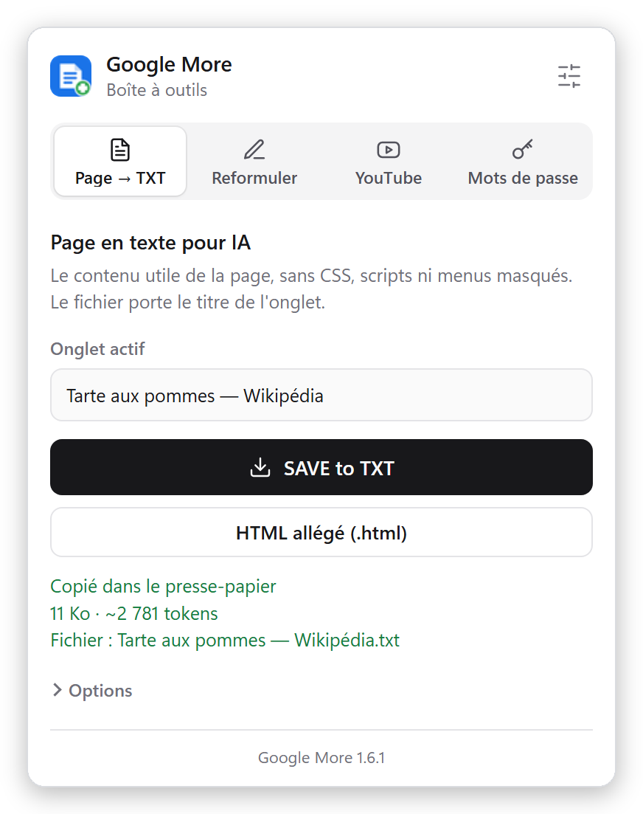
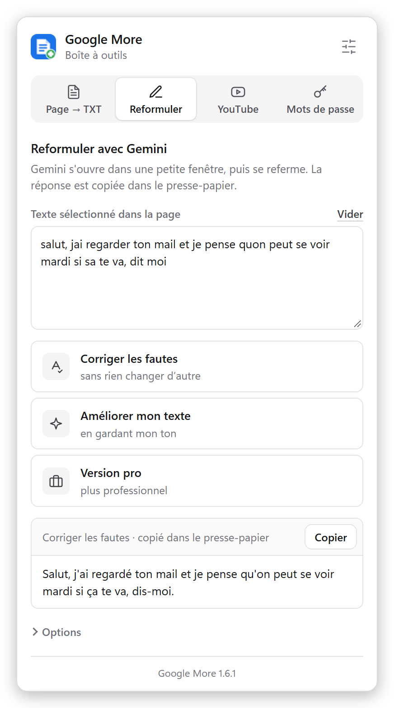
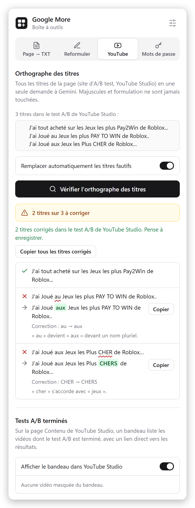
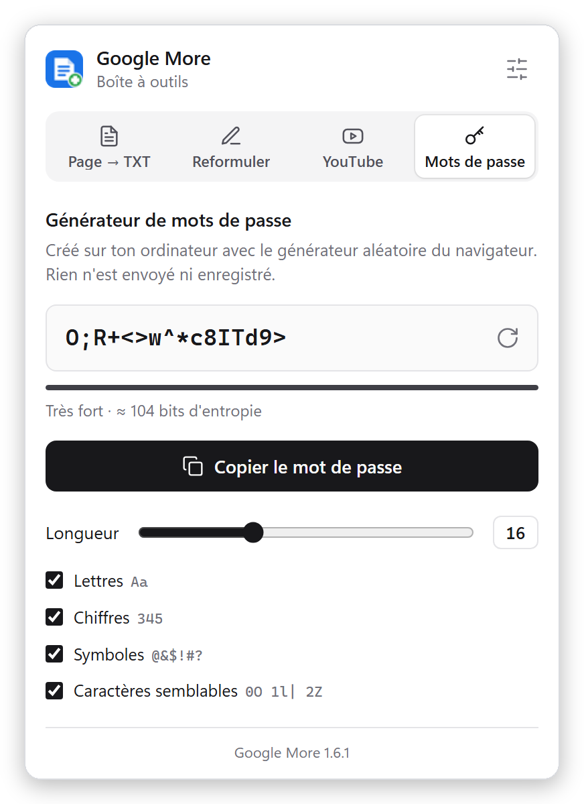

<div align="center">


# Google More

Une boîte à outils pour **Opera / Chrome** : enregistre une page en texte léger pour une IA, reformule tes messages avec Gemini, vérifie l'orthographe de tes titres YouTube, repère tes tests A/B terminés dans YouTube Studio et génère des mots de passe solides.

[**⬇ Télécharger l'extension**](https://github.com/ConejoCORP/Google-More/releases/latest/download/google-more.zip) · [Releases](https://github.com/ConejoCORP/Google-More/releases) · [Installation](#prise-en-main)



</div>

## Ce que ça fait

Google More regroupe dans un seul popup les petits outils qui manquent au navigateur quand on travaille avec une IA et sur YouTube. Chaque catégorie a son onglet : **Page → TXT**, **Reformuler**, **YouTube** et **Mots de passe**. L'interface est sobre, en gris anthracite, et passe en thème sombre avec celui de Windows.

Un clic sur **SAVE to TXT** enregistre tout le contenu utile de la page dans un `.txt` nommé d'après le titre de l'onglet, et le copie dans le presse-papier, prêt à coller dans ChatGPT, Claude ou Gemini. **Reformuler** et la vérification des titres envoient ton texte à **Gemini** avec le bon prompt, sans clé d'API : l'extension pilote ta propre session et te rend directement la réponse.

Dans **YouTube Studio**, un panneau apparaît en haut de la page Contenu dès qu'un test A/B est terminé, avec un bouton qui t'emmène droit sur les résultats pour choisir la version gagnante.

Et quand il te faut un mot de passe, l'onglet **Mots de passe** en génère un aussitôt, comme le générateur de Dashlane, à copier en un clic.

## Pourquoi pas juste copier-coller dans une IA ?

Parce que le HTML d'une page est énorme et plein de bruit : la page d'achat de l'iPhone pèse **762 Ko** copiée depuis F12, pour **43 Ko** de vrai contenu. Un simple Ctrl+A, lui, perd la structure (titres, tableaux, liens). Pour reformuler, il faut ouvrir Gemini, retaper le prompt, attendre puis recopier la réponse : ici, c'est un bouton. Et une IA « corrige » volontiers les majuscules de tes titres YouTube, alors qu'elles sont voulues : ici, un garde-fou l'en empêche.

## Fonctionnalités

- 📄 **SAVE to TXT** — tout le contenu utile de la page en Markdown, enregistré sous le titre de l'onglet et copié dans le presse-papier
- 🧹 **Nettoyage malin** — CSS, scripts, icônes et éléments masqués retirés ; Shadow DOM inclus (YouTube), et les prix « invisibles » d'Apple gardés
- 🪶 **5 à 20 fois plus léger** que le HTML d'origine, avec une variante **HTML allégé** quand la structure compte
- ✍️ **Reformuler avec Gemini** — corriger les fautes sans rien changer, améliorer en gardant ton ton, ou passer en version pro
- 🎯 **Texte pris tout seul** — la sélection de la page, sinon le contenu du presse-papier
- 🎬 **Orthographe des titres YouTube** — tous les titres d'un test A/B en une seule demande, sur ton site d'A/B test ou dans la fenêtre « Tests A/B » de YouTube Studio
- 🔠 **Majuscules intouchables** — la réponse de Gemini est comparée mot à mot à ton titre : seule l'orthographe peut changer
- 🔁 **Correction automatique** des titres fautifs, directement dans leurs champs (option)
- 🧪 **Tests A/B terminés** — panneau en haut de la page Contenu de YouTube Studio, avec pour chaque vidéo un bouton **Voir les résultats** qui ouvre ses statistiques et encadre la carte « Test A/B »
- 🙈 **Masquer les tests déjà traités** — YouTube garde la mention « Test A/B terminé » après ton choix : un clic la retire du panneau, avec **Annuler** juste après
- ⬆️ **Mise à jour automatique** depuis GitHub — pastille **MAJ** sur l'icône, puis un clic : les nouveaux fichiers s'installent dans le dossier de l'extension
- 🔄 **Bandeau « Recharger l'extension »** quand le code a été mis à jour mais pas rechargé
- 🔑 **Générateur de mots de passe** — de 4 à 40 caractères, lettres, chiffres, symboles, avec ou sans caractères semblables (0O 1l|), robustesse affichée et copie en un clic
- ⚙️ **Paramètres** (bouton en haut à droite du popup) — masquer le bandeau des tests A/B dans YouTube Studio si tu n'en veux pas

<div align="center">

&nbsp;&nbsp;

&nbsp;&nbsp;

</div>

## Prise en main

1. [**Télécharge `google-more.zip`**](https://github.com/ConejoCORP/Google-More/releases/latest/download/google-more.zip) et décompresse-le **là où il restera** (pas dans Téléchargements, qu'on vide un jour ou l'autre) : par exemple `Documents\google-more`.
2. Ouvre `opera://extensions` (ou `chrome://extensions`), active le **Mode développeur**, clique **Charger une extension non empaquetée** et choisis le dossier `google-more` obtenu.
3. Une page **Bienvenue** s'ouvre toute seule : clique **Choisir le dossier** et désigne ce même dossier `google-more`. C'est le moment, tu sais encore où il est. Si tu fermes la page sans le faire, le popup te le rappelle avec un bandeau **Choisis le dossier…**
4. Épingle l'icône dans la barre d'outils.
5. Pour les outils Gemini, connecte-toi une fois à [gemini.google.com](https://gemini.google.com) dans le navigateur.
6. Clique sur l'icône, choisis l'onglet de l'outil, et c'est parti. Le panneau des tests A/B, lui, s'affiche tout seul sur la page Contenu de YouTube Studio.

Ensuite, plus besoin de retélécharger ni de chercher le dossier : quand une nouvelle version sort, une pastille **MAJ** apparaît sur l'icône et le popup propose **Mettre à jour**.

*(Tu peux aussi cloner le dépôt avec `git clone https://github.com/ConejoCORP/Google-More.git`. Après une mise à jour du dossier, clique sur ↻ dans la page des extensions ; si tu oublies, le popup affiche un bandeau pour le faire à ta place.)*

## Comment ça marche

**SAVE to TXT** parcourt la page telle que le navigateur l'affiche, Shadow DOM compris, garde ce qui est visible et le convertit en Markdown : titres, listes, tableaux, liens, champs de formulaire. Le fichier commence par un en-tête (titre, URL, date, description) pour que l'IA sache d'où vient le texte.

**Reformuler** et **Titres YouTube** n'utilisent pas de clé d'API : l'extension ouvre une petite fenêtre Gemini au premier plan (dans un onglet en arrière-plan, Gemini ne rédige pas), écrit le prompt, attend la fin de la réponse, la récupère, puis referme la fenêtre et te rend la main. Pendant ce temps, l'icône affiche « … », puis « ✓ ». Si quelque chose bloque (connexion demandée, limite atteinte), la fenêtre reste ouverte pour que tu voies le problème.

**Le garde-fou des titres** : Gemini renvoie un rapport titre par titre, que l'extension compare mot à mot avec l'original. Un changement de majuscules ou de ponctuation (« .. » → « ... ») n'est jamais compté comme une faute, et la casse d'origine est reportée sur le mot corrigé (« CHER » → « CHERS »). Quand la fenêtre « Tests A/B » de YouTube Studio est ouverte, seuls ses titres sont vérifiés, pas celui de la page derrière.

**Le panneau des tests A/B** lit la liste des vidéos de la page Contenu : chaque ligne marquée « Test A/B terminé » y apparaît, avec sa miniature et sa date. **Voir les résultats** ouvre l'onglet Aperçu des statistiques de la vidéo par la navigation interne de Studio, sans recharger la page, puis fait défiler jusqu'à la carte « Test A/B » et l'encadre : il ne reste qu'à cliquer sur **Gérer le test**. Ctrl+clic ouvre les résultats dans un nouvel onglet. Les vidéos masquées sont retenues par l'extension ; les réglages (activer le panneau, tout réafficher) sont dans l'onglet **YouTube** du popup.

**Le générateur de mots de passe** tourne entièrement dans le popup : le hasard vient de `crypto.getRandomValues`, le générateur cryptographique du navigateur, avec un tirage par rejet pour qu'aucun caractère ne sorte plus souvent qu'un autre. Chaque type de caractères coché (minuscules, majuscules, chiffres, symboles) apparaît au moins une fois. Seuls les réglages sont retenus ; le mot de passe n'est ni enregistré ni envoyé, et disparaît à la fermeture du popup. La robustesse affichée est l'entropie, longueur × log2(taille de l'alphabet) : un mot de passe de 16 caractères avec tous les types atteint environ 104 bits, « Très fort ».

## Mise à jour automatique

Au démarrage du navigateur, au rechargement de l'extension et à chaque ouverture du popup, l'extension lit [`version.json`](version.json) sur GitHub. Si une version plus récente existe :

1. une pastille **MAJ** s'affiche sur l'icône, et un bandeau **Version x disponible** en haut du popup ;
2. **Mettre à jour** ouvre une page dédiée, qui montre les nouveautés ;
3. **Mettre à jour maintenant** télécharge tous les fichiers, les écrit dans le dossier de l'extension, puis la recharge. Rafraîchis ensuite tes onglets YouTube Studio (F5).

Aucune API ne permet à une extension de réécrire ses propres fichiers : on passe par l'accès aux dossiers du navigateur. Il faut donc lui montrer **une fois** le dossier de l'extension (celui qui contient `manifest.json`) : dès l'installation, sur la page **Bienvenue** qui s'ouvre toute seule, ou plus tard avec le bandeau du popup, ou à la première mise à jour si tu l'as passée. Une extension déjà installée avant l'arrivée de la mise à jour automatique ouvre aussi la page **Bienvenue**, une seule fois. Il est ensuite mémorisé ; la page de mise à jour dit lequel et permet d'en choisir un autre. Le navigateur peut encore te demander de **confirmer l'accès** d'un clic.

Dans le popup, **Paramètres → Mises à jour** : **Rechercher une mise à jour** vérifie sur place, sans quitter le popup (« À jour », ou « Version x disponible » et le bouton devient **Mettre à jour**), et **Dossier des mises à jour** montre le dossier mémorisé, avec un bouton pour le choisir ou le changer. Le lien **Voir son emplacement** ouvre la fiche de l'extension, où le chemin du dossier est écrit à « Chargée depuis ».

Garde-fous : tout est téléchargé **avant** d'écrire quoi que ce soit (une coupure réseau ne laisse pas l'extension à moitié à jour), seuls les fichiers qui ont **changé** sont réécrits, `manifest.json` est écrit en dernier, le dossier choisi doit bien être celui que le navigateur a chargé, et la seule adresse contactée est `raw.githubusercontent.com`, sans cookie. Si un fichier ne peut pas être écrit (un antivirus qui le bloque, par exemple), les autres le sont quand même, la page dit lequel, et la nouvelle version n'est pas annoncée tant que tout n'est pas en place. Ça ne concerne que l'installation « non empaquetée » décrite plus haut. **Brave** coupe l'accès aux dossiers par défaut : la page explique comment l'activer dans `brave://flags/#file-system-access-api`. Mécanisme repris de [youtube-tools](https://github.com/ConejoCORP/youtube-tools).

## Ce que pèse une page

Mesuré pendant le développement, sur de vraies pages :

| Page | HTML complet | SAVE to TXT |
| --- | --- | --- |
| Achat d'iPhone sur apple.com | 762 Ko (copie F12) | 43 Ko, prix et options compris |
| Configurateur Peugeot 308 | 773 Ko (copie F12) | 17 Ko |
| Wikipédia, « Tarte aux pommes » | 107 Ko | 11 Ko, ou 4,8 Ko sans les URL des liens |

Sur le configurateur Peugeot, tout le texte visible à l'écran est présent. Seuls manquent le panneau de cookies caché et les fiches techniques repliées, récupérables avec l'option **Inclure les éléments masqués**.

Sur la page Apple, chaque prix existe en double : une version visuelle cachée aux lecteurs d'écran, et une version texte invisible à l'écran. SAVE to TXT garde la version texte, et jette les textes pour lecteurs d'écran qui ne font que répéter l'affichage (« Note de bas de page », « s'ouvre dans une nouvelle fenêtre »).

## Limites

- Les pages internes du navigateur (`opera://`, `chrome://`), la boutique d'extensions et les PDF ne sont pas lisibles par une extension.
- Les outils Gemini demandent d'être connecté à Gemini, et chaque demande crée une conversation dans ton historique.
- Ne réduis pas la petite fenêtre Gemini pendant qu'elle travaille.
- L'extension pilote la page de Gemini : si Google la modifie, il faudra adapter `tools/gemini-rewrite/gemini.js` (les repères utilisés sont listés en tête du fichier).
- Le panneau des tests A/B ne lit que les vidéos de la page affichée dans Studio (30 par page) : change de page pour voir les tests plus anciens. Si Studio change sa page, c'est `tools/youtube-ab/ab-panel.js` qu'il faudra adapter.

## Développer

Les pages de test se servent avec un petit serveur local, lancé dans le dossier de l'extension :

```bash
python -m http.server 8766
```

- `http://127.0.0.1:8766/test/sample.html` : page piège pour SAVE to TXT (listes, tableaux, formulaires, Shadow DOM, éléments masqués).
- `http://127.0.0.1:8766/test/gemini-mock.html` : maquette de la page Gemini pour tester `gemini.js` sans rien envoyer.
- `http://127.0.0.1:8766/test/popup-harness.html?tab=page` (ou `rewrite`, `titles`, `password`) : le vrai popup avec des données de démonstration.

Les tests de la mise à jour automatique (GitHub, dossier et service worker simulés, sans rien envoyer) :

```bash
node test/test-update.js
node test/test-welcome.js
```

Le banc d'essai du popup simule aussi GitHub : `&maj=1.9.0` (nouvelle version), `&maj=404` (dépôt injoignable), ou rien (à jour) ; `?tab=settings` ouvre les Paramètres.

Pour régénérer les captures de ce README (Edge ou Chrome sans fenêtre, nécessite Pillow) :

```bash
python test/screenshots.py
```

| Fichier | Rôle |
| --- | --- |
| `manifest.json` | Déclaration de l'extension et de ses permissions |
| `popup.html` / `popup.css` / `popup.js` | La boîte à outils, un onglet par catégorie |
| `background.js` | Service worker : téléchargement de SAVE to TXT, chargement de la partie Gemini |
| `offscreen.html` / `offscreen.js` | Document caché qui écrit dans le presse-papier pour le service worker |
| `tools/page-to-text/` | Conversion de la page en Markdown ou HTML allégé |
| `tools/gemini-rewrite/` | Prompts, pilotage de la fenêtre Gemini, onglet Reformuler |
| `tools/youtube-titles/` | Prompt des titres, comparaison mot à mot, lecture et remplacement des titres |
| `tools/youtube-ab/` | Panneau des tests A/B terminés dans YouTube Studio, et ses réglages dans le popup |
| `tools/password/` | Générateur de mots de passe et calcul de robustesse, onglet Mots de passe |
| `tools/update/` | Mise à jour automatique : lecture de `version.json`, page de mise à jour, bandeau du popup |
| `tools/version.js` | Numéro de version du code, comparé entre le popup et le service worker |
| `release.js` / `version.json` | Publication d'une version, et annonce lue par la mise à jour automatique |

**Ajouter un outil** : crée un dossier `tools/<nom-outil>/`, ajoute un bouton dans `.tabs` et une `<section data-panel="…">` dans `popup.html`, branche son script, puis déclare les permissions nécessaires dans `manifest.json`.

## Publier une nouvelle version (pour les mainteneurs)

Augmente `GM_BUILD` dans `tools/version.js` et `version` dans `manifest.json`, avec la même valeur, puis committe et pousse. Ensuite :

```bash
node release.js "Ce qui change"
```

Le script vérifie que les deux numéros de version concordent et que le dépôt est propre et poussé, puis écrit et pousse `version.json` (la version, le commit publié et la liste des fichiers de l'extension, que lit la mise à jour automatique), fabrique `dist/google-more.zip` avec les seuls fichiers de l'extension, crée le tag et publie la release. L'archive porte toujours le même nom, donc le lien de téléchargement de ce README ne change jamais. Nécessite [GitHub CLI](https://cli.github.com/) authentifié.
